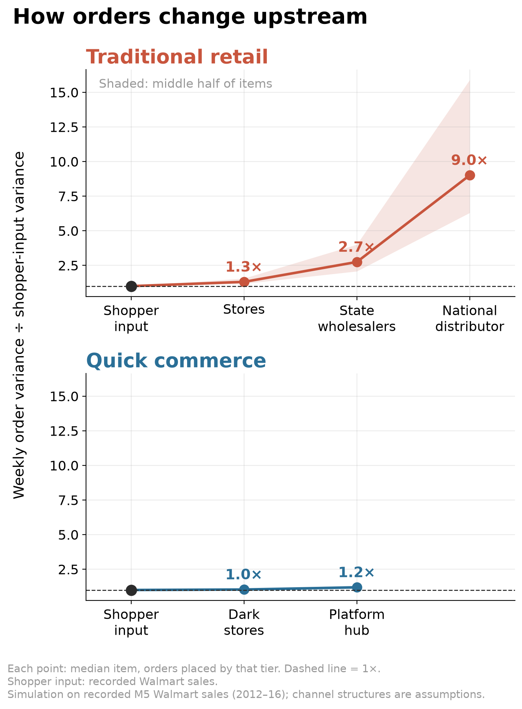
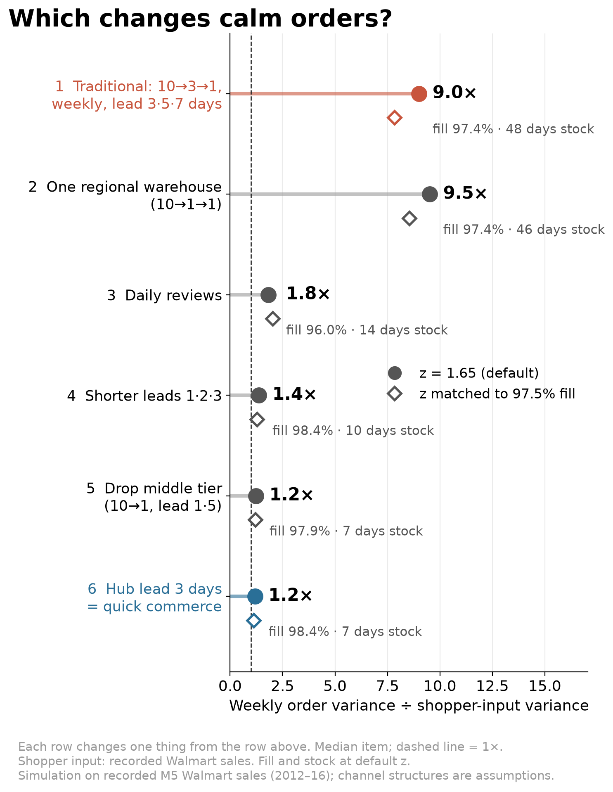
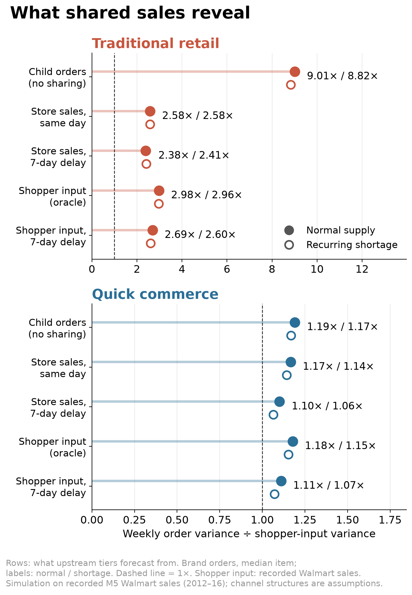
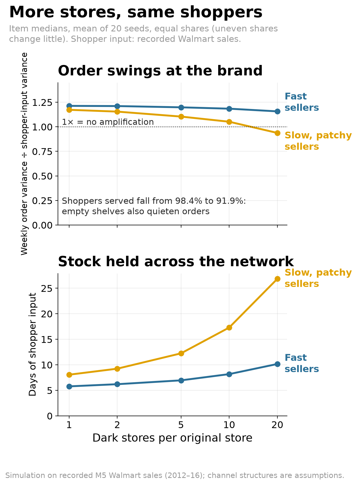
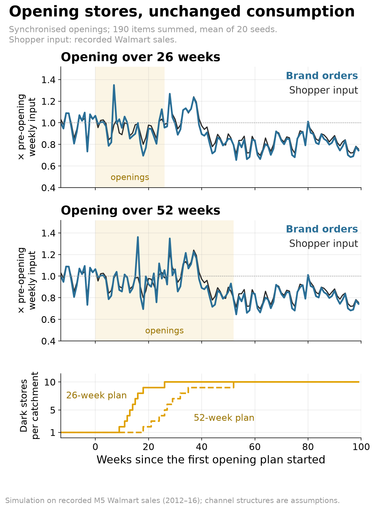
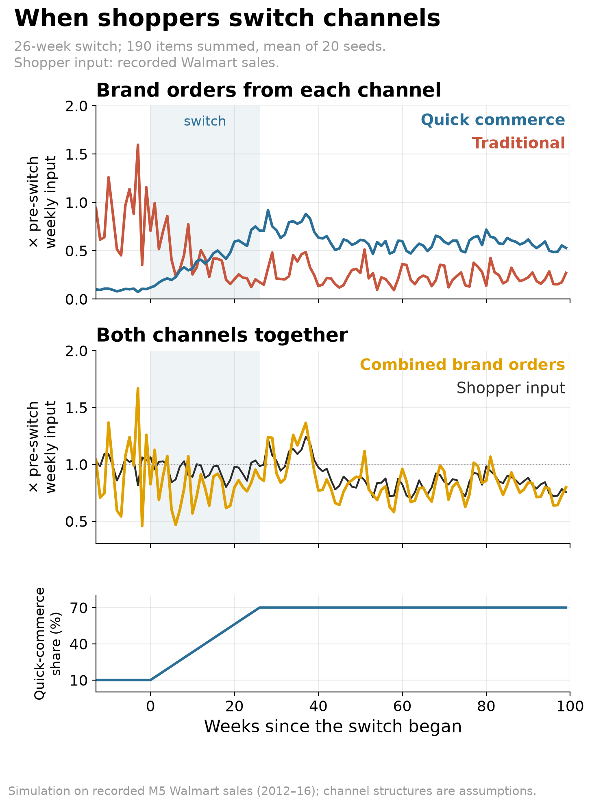

<!-- hero: charts/e08_structure.png. Daily replenishment produces the largest structural reduction, and the channel ranking survives alternative forecasting settings and product segments. Opening surges are temporary and depend on synchronization. -->

Picture a demand planner at a biscuit brand. The sales team says shoppers are buying much as before. Yet distributor orders arrive in bursts, followed by silence. The planner has to set the factory schedule and explain why a warehouse full of biscuits can coexist with urgent replenishment requests.

Now imagine some of those shoppers buying through an app. The brand receives opening orders for new dark stores while its distributors cut purchases. The biscuits still reach kitchen cupboards. The signals reaching the factory have changed.

## How a biscuit gets to a kirana

In a simplified traditional chain, biscuits travel from the brand through a distributor and wholesaler to the kirana. Orders travel back the other way. Each business must decide how much to buy before it knows exactly what its customers will need.

Give those businesses weekly ordering cycles and long delivery waits, and a modest change at the shelf can become a much larger change upstream. This is the bullwhip effect. Our **swing ratio** measures it: the variance of weekly brand orders divided by the variance of weekly shopper input, taking the median across products. A ratio of 9× means nine times the variance, not nine times the order volume or peak.

We fed recorded Walmart sales into this simulated chain. The swing ratio climbed from 1.3× at stores to 2.7× at state wholesalers and **9.0× at the national distributor**.

Real calendar spikes show the same pattern. Around the Super Bowl, the brand's busiest order week in traditional trade typically came a week after the shoppers' busiest week and was 1.5× its size, against about 1.0× in quick commerce. Treat this as descriptive: the data hold only four Super Bowls, and each overlaps SNAP food-benefit days.

## Sensible decisions can produce wild orders

The planner's problem starts with decisions that make sense to each business on its own. [Lee, Padmanabhan and Whang (1997)](https://doi.org/10.1287/mnsc.43.4.546) named four classic causes of the bullwhip effect:

- **Forecast updating.** Each business revises its forecast after a strong or weak week, and its order moves more than its sales did.
- **Order batching.** Ordering weekly, or in large lots, turns steady buying into bursts and gaps.
- **Price promotions.** Discounts encourage buying ahead, so orders run ahead of what shoppers buy and then fall away.
- **Shortage gaming.** When a supplier rations stock, buyers ask for more than they need and cut back once supply returns.

A fifth cause is behavioral. In the Beer Game studied by [Sterman (1989)](https://doi.org/10.1287/mnsc.35.3.321) and [Croson and Donohue (2006)](https://doi.org/10.1287/mnsc.1050.0436), players tend to overlook stock they have already ordered, so they order again.

Our traditional chain has the ingredients for these causes: weekly orders, delivery waits of up to a week at each tier, and forecasts revised at every order. Grouping stores does not fix it. Replacing ten middle warehouses with one cut stock by 17.5% but raised the brand's swing ratio by 15.2%.

## The same biscuit takes a shorter route

Indian quick commerce changes the journey to the kitchen. Platforms such as Blinkit, Zepto and Instamart use dark stores to fulfill app purchases and offer delivery in minutes. Stock sits close to shoppers, and the platform records each sale directly.

Our simplified version replenishes dark stores daily from a city hub. That should weaken batching and reduce the inventory consequences of forecast revisions. Sharing sales data should add less when the platform already has the sales.

But smaller stores divide inventory among more locations. Openings may happen together. Shoppers may switch channels while distributors still hold stock. An algorithm may mistake an empty shelf for weak demand, or repeat the same forecast error across stores.

Our starting hypothesis was that **“the bullwhip stays, for different reasons.”** Faster delivery might quiet the familiar causes while these new ones took their place.

## The orders became calmer than we expected

The simulation mostly contradicted that hypothesis. The same shopper input produced a swing ratio of **1.2× in quick commerce against 9.0× in traditional retail**, a reduction of about 87%.

Daily replenishment did most of the work. After pooling the middle tier, changing reviews from weekly to daily lowered the ratio from 9.5× to 1.8×; shorter delivery waits and removing a stocking tier brought further reductions.

Availability mattered too. Daily ordering alone initially reduced the share of demand fulfilled by 1.45 percentage points; shorter delivery delays restored it. Across the full structural change, median on-hand stock fell from 48.3 to 6.9 days and fulfillment rose from 97.4% to 98.4%.

Forecast updating and shortage gaming became weaker sources of amplification. Batching could still undo progress: imposing weekly orders on quick commerce raised its ratio by 121%. Buying-ahead effects remained similar across channels.

Sales visibility behaved as expected. Letting traditional upstream planners forecast from store sales instead of downstream orders cut amplification by 71.4%, with little change in availability. The benefit in quick commerce was only 2.1%.

For our biscuit planner, sales data would reveal how much of a distributor’s order reflected purchases at the shelf. Its value depends on the distortion already present, a question studied experimentally by [Croson and Donohue (2003)](https://doi.org/10.1111/j.1937-5956.2003.tb00194.x).

The algorithmic problems mostly failed to recreate substantial amplification. Under recurring supply restrictions, learning from stocked-out sales reduced the swing ratio by a small 3.3%, while median fulfillment slipped from 96.1% to 95.5%. Skipping learning whenever shelves ended empty made matters worse: it discarded high-demand observations, leaving median fulfillment at 81.3% even without an imposed shortage.

Sharing forecast errors across stores had a small typical-product effect of 2.1%. In an extreme scenario where the same injected forecast error hits every product and dark store at once, the portfolio swing ratio reached 1.33×, against 1.16× when errors still differed across stores and 1.14× without injected errors.

## Calm orders can hide empty shelves

Dividing each original catchment among twenty dark stores produced the clearest surprise. Median stock doubled from 6.9 to 13.8 days, yet the share of demand fulfilled fell from 98.4% to 91.9%. Orders became calmer.

More inventory across the network did not ensure that a particular shelf had the right product. Intermittent sellers suffered especially. A planner watching only brand orders could miss both the extra stock and the lost sales.

The baseline faster network had saved stock and improved availability. These additional costs appeared when we fragmented it further.

## Openings and channel switches can fool the factory

If a platform opens many stores together, their initial purchases can arrive at the brand together too. In our 26-week expansion scenario, synchronized openings produced a peak weekly orders-to-shopper-input ratio of 1.37×. Staggering openings across catchments reduced it to 1.07×.

The surge did not become a lasting additional bullwhip. Once expansion settled, the swing ratio was 1.16×, with no detectable increase over an established network of the same size. Across the entire expansion, orders were slightly below shopper input despite a stock build; lost sales helped offset opening purchases.

A channel switch could send the opposite signal. If quick commerce’s share rose from 10% to 70% over 26 weeks, our scenario had traditional inventory running down while dark-store inventory grew. Combined brand purchases during that switch fell below unchanged shopper demand by roughly four weeks of purchases [27.6 days of pre-switch average input].

That gap includes simulated unmet demand, so it compares orders with shopper input rather than completed sales. Afterward, the swing ratio was 2.52× versus 2.57× in a network already operating at 70% quick commerce. The transition did not establish lasting additional amplification.

These are scenarios, not forecasts for a platform. They suggest four checks for a brand team:

- **Examine replenishment cadence first.** Daily ordering produced the largest structural reduction; faster delivery helped preserve availability.
- **Read orders beside sales, stock and availability.** Fragmentation and stockout learning made orders look calm while shelves emptied.
- **Separate openings and channel switches from demand growth.** Track opening fills and distributor destocking, and stagger openings where possible.
- **Share sell-through data with traditional partners.** It reduced amplification by about 71% there, with a small benefit in quick commerce.

Return to the biscuit planner facing a quiet order book. Before cutting the factory schedule, the planner needs to see what shoppers bought, what shelves could not supply, and what distributors still hold. The movement of biscuits through those inventories can explain a silence that the order book alone cannot.

## What this is and isn’t

This is a simulation driven by real Walmart US sales. The channel structures are assumptions, not measurements of Blinkit, Zepto or Instamart. Recorded sales already hide any historical stockouts. Across forecasting responsiveness settings of 0.02–0.10, traditional swing ratios ranged from 2.4× to 30.2× and quick commerce from 1.07× to 1.36×. The ranking held after removing trends, using shorter measurement windows and separating fast from intermittent sellers.

## Method

We used [M5 Walmart sales](https://doi.org/10.1016/j.ijforecast.2021.07.007) from Nixtla’s public mirror: 190 food items across ten stores in three states, spanning 2011–2016. The sample contained 100 fast sellers and 90 intermittent sellers; only 90 intermittent items met the first-year eligibility rule. Selection and forecast initialization used that first year. Simulation covered days 365–1941, with measurements on days 505–1939 after 140 settling days.

Traditional retail had stores, state wholesalers and a national distributor, with weekly reviews and delivery delays of 3/5/7 days. Quick commerce had dark stores and a hub, with daily reviews and delays of 1/3 days. Both replenished toward inventory targets using exponentially smoothed forecasts (alpha 0.05) and safety factor 1.65, with lost shelf sales, upstream backlogs and unlimited brand supply.

Structural changes were assessed in sequence. The chart’s alternative safety factors were fitted to a training-period service target; they did not guarantee equal availability afterward. Shortage gaming imposed inflated firm orders. Code is available on request.

## References

- Lee, H. L., Padmanabhan, V., & Whang, S. (1997). [Information Distortion in a Supply Chain: The Bullwhip Effect](https://doi.org/10.1287/mnsc.43.4.546).
- Sterman, J. D. (1989). [Modeling Managerial Behavior: Misperceptions of Feedback in a Dynamic Decision Making Experiment](https://doi.org/10.1287/mnsc.35.3.321).
- Croson, R., & Donohue, K. (2003). [Impact of POS Data Sharing on Supply Chain Management: An Experimental Study](https://doi.org/10.1111/j.1937-5956.2003.tb00194.x).
- Croson, R., & Donohue, K. (2006). [Behavioral Causes of the Bullwhip Effect and the Observed Value of Inventory Information](https://doi.org/10.1287/mnsc.1050.0436).
- Makridakis, S., Spiliotis, E., & Assimakopoulos, V. (2022). [The M5 Competition: Background, Organization, and Implementation](https://doi.org/10.1016/j.ijforecast.2021.07.007).