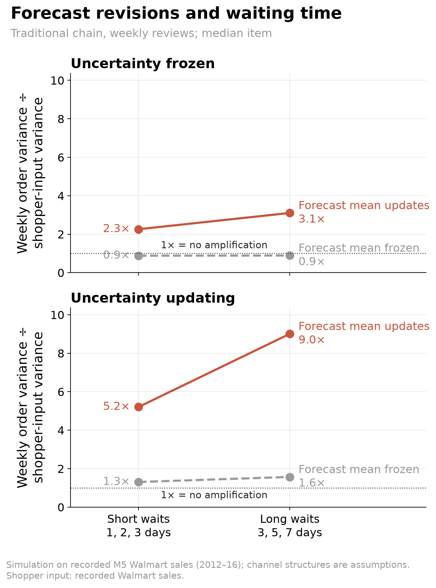
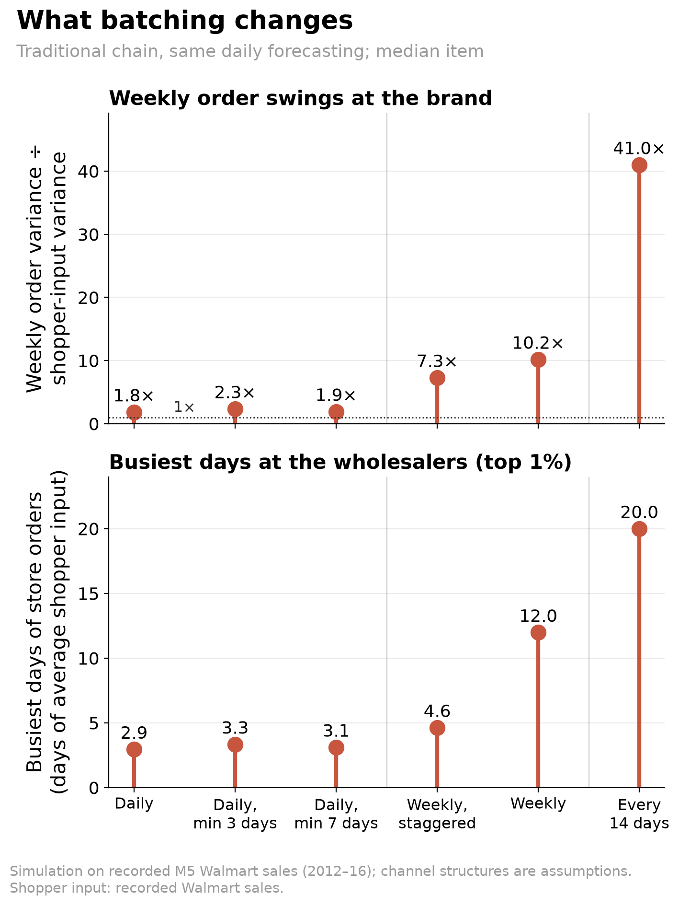
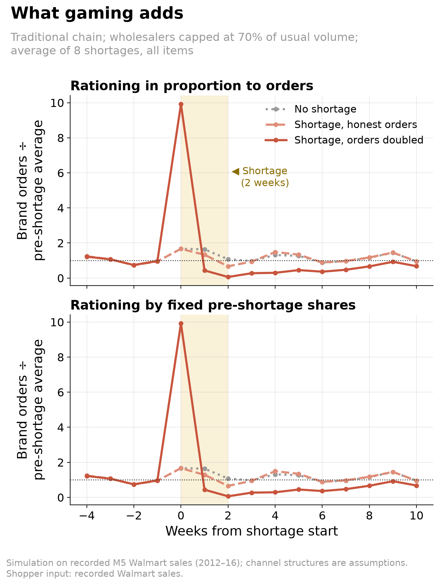

<!-- hero: charts/e08_structure.png. Daily replenishment produces the largest structural reduction, and the channel ranking survives alternative forecasting settings and product segments. Opening surges are temporary and depend on synchronization. -->

We expected quick commerce to keep the bullwhip alive for different reasons. Our simulation mostly overturned that idea: daily replenishment sharply reduced the swings in orders reaching the brand. Fragmentation and growth brought costs in stock, empty shelves and temporary shocks. During a channel switch, brand purchases fell about four weeks short of shopper demand, even though total demand had not fallen.

For an Indian FMCG brand selling through kiranas and distributors alongside dark-store platforms, this distinction matters. Distributor destocking and a platform’s opening orders can pull brand purchases in opposite directions.

## What the bullwhip effect is

The bullwhip effect occurs when orders become more variable as they travel upstream from shoppers. Our **swing ratio** divides the variance of weekly brand orders by the variance of weekly shopper input, then takes the median across products. Above 1 means amplification; 9× does not mean order volumes or peaks are nine times larger.

The same recorded shopper purchases produced a swing ratio of **9.0× in traditional retail and 1.2× in quick commerce**. In the traditional chain, it climbed from 1.3× at stores to 2.7× at state wholesalers and 9.0× at the national distributor.

Real calendar spikes show the same pattern. Around the Super Bowl, the brand's busiest order week in traditional trade typically came a week after the shoppers' busiest week and was 1.5× its size, against about 1.0× in quick commerce. Treat this as descriptive: the data hold only four Super Bowls, and each overlaps SNAP food-benefit days.

## Why traditional chains whip

The classic causes involve decision rules: reacting to forecast revisions, inflating orders during shortages and overlooking stock already on order. We also tested an algorithmic blind spot in quick commerce: learning from sales suppressed by empty shelves. Our models let us change these rules separately.

Forecast updating, batching, price incentives and shortage gaming are the mechanisms identified by [Lee, Padmanabhan and Whang (1997)](https://doi.org/10.1287/mnsc.43.4.546). Forecast updating had a large effect here: with uncertainty estimates fixed, it raised the traditional swing ratio from 0.89× to 3.10× under long delivery delays.

Longer waits make each forecast revision affect more planned inventory. Freezing forecasts reduced swings but also hurt availability.

Batching mattered even when forecasting stayed daily. Weekly ordering produced a swing ratio of 10.2×, compared with 1.8× for daily ordering. Staggering stores’ weekly ordering days reduced it by 28%; that benefit was smaller and uncertain when forecasts updated only at reviews.

The fortnightly point includes alternating order and empty weeks. Minimum-batch rules also caused substantial lost sales, so their lower ratios should not be read as successful smoothing.

Shortage gaming made the traditional chain much less stable. Under the same supply restriction, doubling replenishment requests raised the swing ratio from 8.8× to 20.7×. The shortage alone had no clear amplification effect, although it reduced availability.

Buying ahead had a small effect: adding up to 14 days of forecast demand to inventory targets raised the ratio by 9.9%, below our 10% practical threshold. Moving the discount signal to other dates produced a larger increase. Retail prices served as hypothetical procurement signals, so this does not establish an effect of Walmart’s actual promotion calendar.

Pooling saved stock without calming orders. Replacing ten middle warehouses with one cut on-hand inventory by 17.5%, but increased the brand’s swing ratio by 15.2%.

Overlooking stock already ordered barely changed order swings here. Counting only 75% of stock already ordered changed the ratio by an uncertain 1.1%: weekly reviews and delivery delays of a week or less left little to overlook. This narrow result does not overturn the inventory-feedback mechanisms studied by [Sterman (1989)](https://doi.org/10.1287/mnsc.35.3.321) and [Croson and Donohue (2006)](https://doi.org/10.1287/mnsc.1050.0436).

## What quick commerce changes

Daily replenishment delivered the largest reduction. After pooling the middle tier, changing orders from weekly to daily lowered the ratio from 9.5× to 1.8×. Shorter delivery delays lowered it further, followed by a smaller benefit from removing a stocking tier.

The daily-ordering step initially reduced the share of demand fulfilled by 1.45 percentage points; shorter delivery delays restored it. Across the complete change in structure, the swing ratio fell by 86.8%, median on-hand stock fell from 48.3 to 6.9 days, and the share fulfilled rose from 97.4% to 98.4%.

The faster structure weakened forecast updating and shortage gaming. Batching remained dangerous: imposing weekly orders on quick commerce raised its ratio by 121%. Buying-ahead effects were similar across channels.

Sharing store sales helped traditional upstream planners considerably. Forecasting from those sales instead of downstream orders cut the ratio by 71.4%, with little change in availability. The benefit was only 2.1% in quick commerce.

The value of sharing sales depends on how distorted the existing signal is, a question examined experimentally by [Croson and Donohue (2003)](https://doi.org/10.1111/j.1937-5956.2003.tb00194.x).

## Where the cost goes

Fragmentation increased stock while shelves became less reliable. Dividing each original catchment among twenty dark stores doubled median on-hand inventory from 6.9 to 13.8 days. The swing ratio fell, but the share of demand fulfilled dropped from 98.4% to 91.9%, with intermittent sellers particularly affected.

Expansion produced a brief surge when openings were synchronized. During the 26-week expansion, the peak weekly orders-to-shopper-input ratio reached 1.37×; staggering openings across catchments reduced it to 1.07×.

After expansion settled, the swing ratio was 1.16×, with no detectable increase over an established network of the same size. Across the entire expansion, orders were slightly below shopper input despite a physical inventory build: lost sales helped offset opening purchases.

Channel migration released more stock than the expanding channel needed. When quick commerce’s share rose from 10% to 70% over 26 weeks, traditional inventory ran down while dark-store inventory grew. Combined brand purchases fell short of the unchanged demand by roughly four weeks of shopper purchases [27.6 days of pre-switch average input].

That gap includes simulated unmet demand, so it is measured against shopper input, not completed sales. Afterward, the swing ratio was 2.52× versus 2.57× in a network already operating at 70% quick commerce. The transition did not establish lasting additional amplification.

Learning from stocked-out sales also made orders look calmer. Under recurring supply restrictions, the swing ratio fell by a small 3.3%, while the median share of demand fulfilled slipped from 96.1% to 95.5%. Our attempted correction, skipping learning whenever shelves ended empty, discarded high-demand observations and failed badly: median fulfillment was only 81.3% even without an imposed shortage.

Sharing forecast errors across stores had a small typical-product effect of 2.1%. In an extreme scenario where the same injected forecast error hits every product and dark store at once, the portfolio swing ratio reached 1.33×, against 1.16× when errors still differed across stores and 1.14× without injected errors.

## What this is and isn’t

This is a simulation driven by real Walmart US sales. The channel structures are assumptions, not measurements of Blinkit, Zepto or Instamart. Recorded sales already hide any historical stockouts. Across forecasting responsiveness settings of 0.02–0.10, traditional swing ratios ranged from 2.4× to 30.2× and quick commerce from 1.07× to 1.36×. The ranking held after removing trends, using shorter measurement windows and separating fast from intermittent sellers.

## What FMCG teams can do

- **Examine replenishment cadence first.** Daily ordering produced the largest structural reduction; delivery speed helped preserve availability.
- **Read orders beside sales, stock and availability.** Fragmentation and stockout learning made orders look calm while shelves emptied.
- **Separate openings and channel switches from demand growth.** Track opening fills and distributor destocking explicitly, and stagger openings where possible.
- **Share sell-through data with traditional partners.** It reduced amplification by about 71% there, with a small benefit in quick commerce.

## Method

We used [M5 Walmart sales](https://doi.org/10.1016/j.ijforecast.2021.07.007) from Nixtla’s public mirror: 190 food items across ten stores in three states, spanning 2011–2016. The sample contained 100 fast sellers and 90 intermittent sellers; only 90 intermittent items met the first-year eligibility rule. Selection and forecast initialization used that first year. Simulation covered days 365–1941, with measurements on days 505–1939 after 140 settling days.

Traditional retail had stores, state wholesalers and a national distributor, with weekly reviews and delivery delays of 3/5/7 days. Quick commerce had dark stores and a hub, with daily reviews and delays of 1/3 days. Both replenished toward inventory targets using exponentially smoothed forecasts (alpha 0.05) and safety factor 1.65, with lost shelf sales, upstream backlogs and unlimited brand supply.

Structural changes were assessed in sequence. The chart’s alternative safety factors were fitted to a training-period service target; they did not guarantee equal availability afterward. Shortage gaming imposed inflated firm orders. Code is available on request.

## References

- Lee, H. L., Padmanabhan, V., & Whang, S. (1997). [Information Distortion in a Supply Chain: The Bullwhip Effect](https://doi.org/10.1287/mnsc.43.4.546).
- Sterman, J. D. (1989). [Modeling Managerial Behavior: Misperceptions of Feedback in a Dynamic Decision Making Experiment](https://doi.org/10.1287/mnsc.35.3.321).
- Croson, R., & Donohue, K. (2003). [Impact of POS Data Sharing on Supply Chain Management: An Experimental Study](https://doi.org/10.1111/j.1937-5956.2003.tb00194.x).
- Croson, R., & Donohue, K. (2006). [Behavioral Causes of the Bullwhip Effect and the Observed Value of Inventory Information](https://doi.org/10.1287/mnsc.1050.0436).
- Makridakis, S., Spiliotis, E., & Assimakopoulos, V. (2022). [The M5 Competition: Background, Organization, and Implementation](https://doi.org/10.1016/j.ijforecast.2021.07.007).